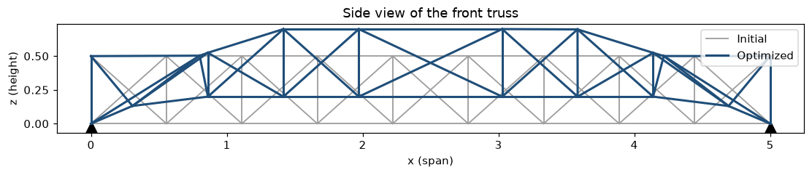
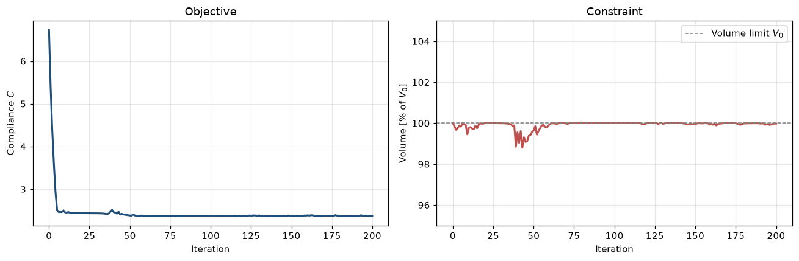
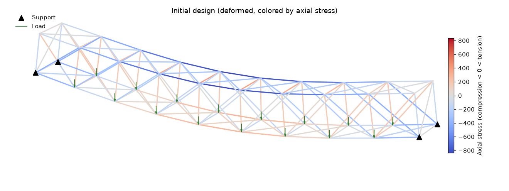
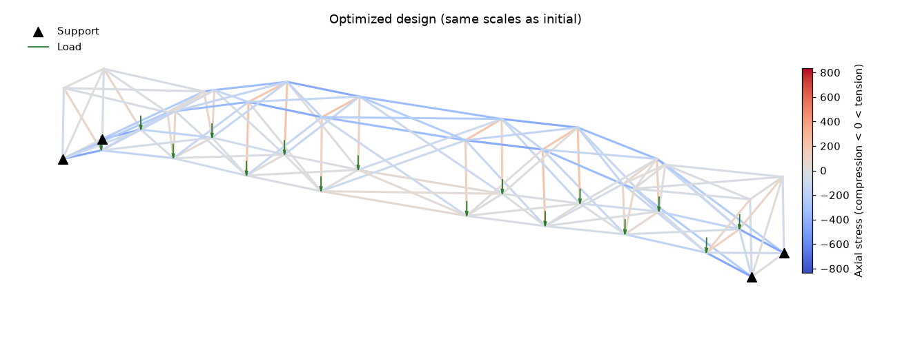

# Shape Optimization of a 3D Truss Bridge

Gradient-based shape optimization of a 3D truss bridge in Python. The optimizer moves the bridge's
nodes so that it carries the same load **about 3x stiffer with the same amount of material**.



| | Initial | Optimized | Change |
|---|---:|---:|---:|
| Compliance (inverse stiffness) | 6.73 | 2.37 | **-65 %** |
| Max. displacement | 5.91 | 2.33 | -61 % |
| Max. axial stress | 834 | 455 | -45 % |
| Material volume | 0.0952 | 0.0952 | 0 % |

## What it does

The structure is a 5 x 0.5 x 0.5 truss bridge made of two planar trusses connected by bracing. It
has 40 nodes and 150 bars, it is pinned at its four bottom corners, and a load acts on every
bottom-chord node (the deck).

The optimization problem:

$$
\min_{\mathbf{x}} \; C(\mathbf{x}) = \mathbf{f}^\top \mathbf{u}(\mathbf{x})
\quad \text{s.t.} \quad
V(\mathbf{x}) = \sum_i A_i\, l_i(\mathbf{x}) \le V_0, \qquad
\mathbf{x}_{\min} \le \mathbf{x} \le \mathbf{x}_{\max}
$$

* **Design variables:** horizontal and vertical positions of all 32 interior nodes (64 variables)
* **Objective:** compliance $C$, the work done by the loads. Lower compliance means a stiffer bridge.
* **Constraint:** total material volume must not exceed the initial volume $V_0$

## How it works

| Component | Implementation |
|---|---|
| Structural analysis | Linear 3D truss **finite element** solver written in PyTorch ([`src/truss.py`](src/truss.py)): element stiffness assembly, solution of $\mathbf{K}\mathbf{u}=\mathbf{f}$, axial stresses |
| Sensitivities | **Automatic differentiation** (PyTorch autograd) through the whole FE solve, no hand-derived gradients |
| Optimizer | **Method of Moving Asymptotes (MMA)** ([`src/optimization.py`](src/optimization.py)): convex separable approximations, adaptive asymptotes, move limits; the subproblem is solved in closed form, and the Lagrange multiplier is found by bisection on the dual |

Most of the improvement happens within the first ~10 iterations, and the material volume stays at the limit $V_0$ (within numerical tolerance):



## Results

| Initial design (deformed, stress-colored) | Optimized design (same scales) |
|---|---|
|  |  |

The optimizer lifts the interior of the truss above the level of the supports. The end panels turn
into steep inclined struts, so the deck load travels to the supports along a more direct, arch-like
path. The peak bar stress drops by 45 %.

The full derivation, code and plots are in
[`bridge_shape_optimization.ipynb`](bridge_shape_optimization.ipynb).

## Run it

```bash
python -m venv .venv
.venv\Scripts\activate          # Windows  (Linux/macOS: source .venv/bin/activate)
pip install -r requirements.txt
jupyter notebook bridge_shape_optimization.ipynb
```

The full optimization runs in a few seconds on a CPU.

## Project structure

```
├── bridge_shape_optimization.ipynb   # problem setup, optimization, results
├── src/
│   ├── truss.py                      # differentiable 3D truss FE solver + 3D plotting
│   └── optimization.py               # MMA optimizer with dual solve
├── images/                           # figures used in this README
└── requirements.txt
```

## Tech stack

Python, PyTorch (autograd, linear algebra), NumPy, Matplotlib, Jupyter

## Possible extensions

* Stress and buckling constraints
* Simultaneous optimization of cross-sectional areas (sizing + shape)
* Multiple load cases (e.g. asymmetric traffic load)

---

*University project in structural optimization. The model is non-dimensional, so the relative
improvements are the meaningful result.*
